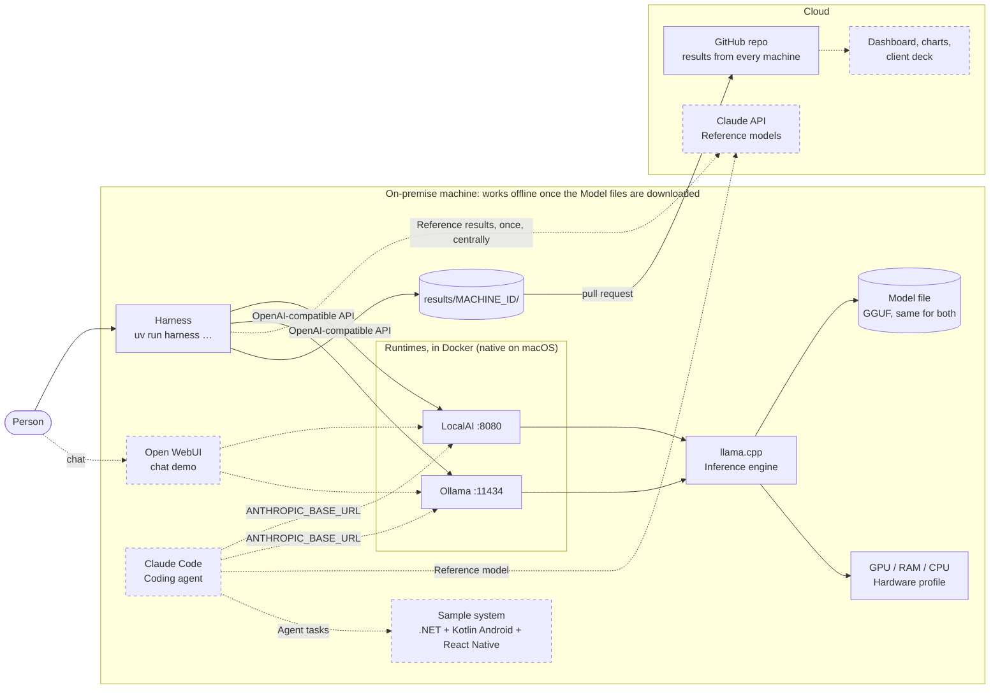
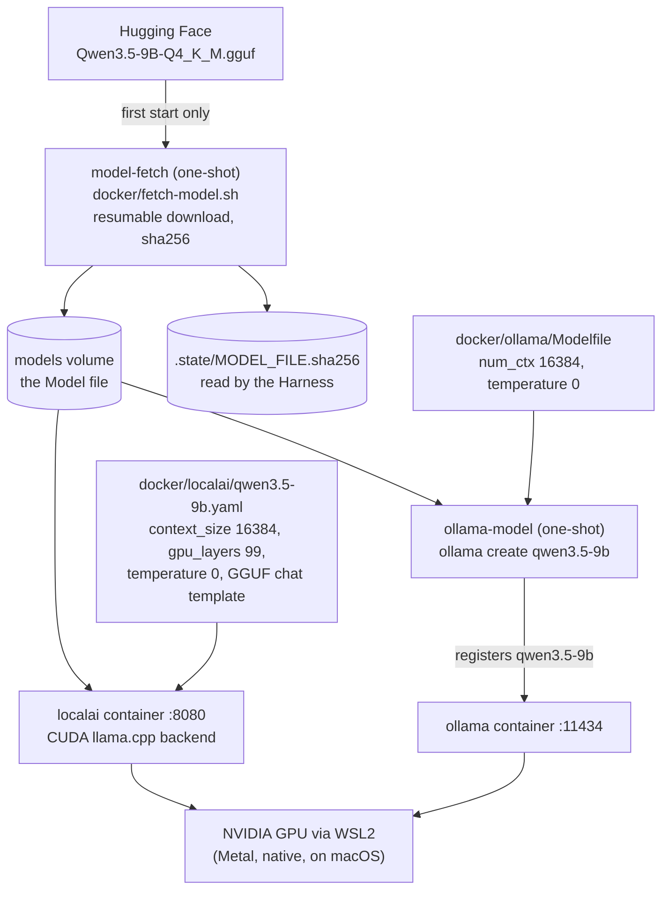
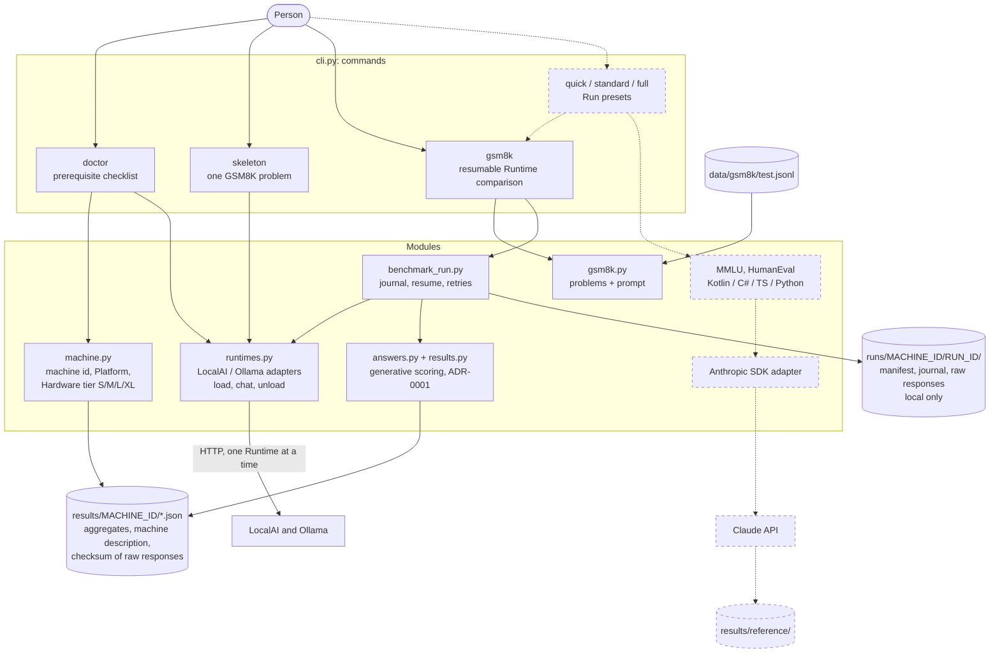
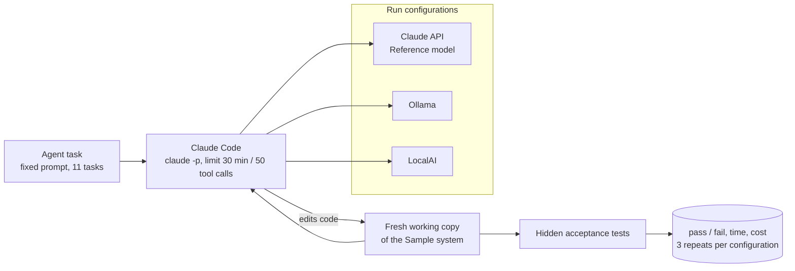
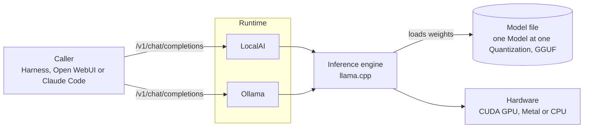
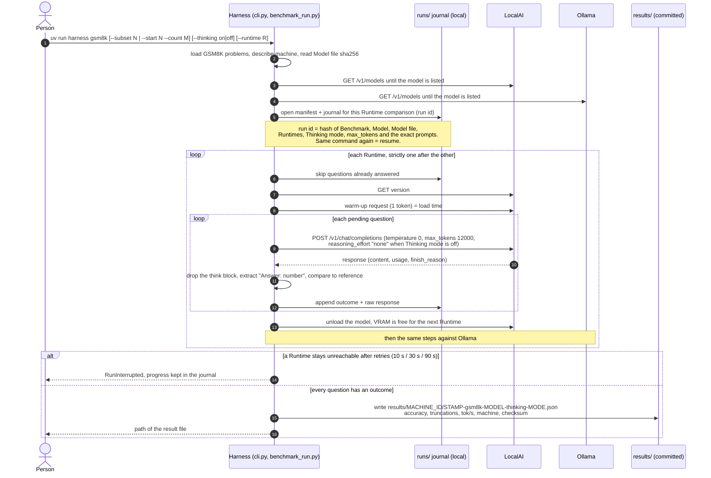

# LocalAI vs Ollama

Running generative AI on-premise with LocalAI and Ollama: comparing the two tools, and measuring how small open models perform against a cloud reference (Claude), both on public benchmarks and as the model behind a coding agent.

## Language

### Running models

**Runtime** (HU: futtatókörnyezet):
Server software that loads Model files and serves them over an HTTP API. In this project: LocalAI and Ollama.
_Avoid_: backend, platform, engine

**Inference engine** (HU: inferencia-motor):
The library underneath a Runtime that actually performs the model computation (e.g. llama.cpp).
_Avoid_: backend, engine (alone), runtime

**Platform** (HU: platform):
The operating system and GPU combination a machine runs, which decides where the Runtimes run: Windows + NVIDIA GPU (Runtimes in Docker) or macOS on Apple Silicon (Runtimes native on Metal).
_Avoid_: OS (alone), host

**Hardware profile** (HU: hardverprofil):
How the model is placed on the machine during a run: fully in VRAM, VRAM + RAM offload (part of the model in system memory), or CPU-only.
_Avoid_: environment, setup

**Hardware tier** (HU: hardverszint):
A class of machines grouped by the memory available to models (dedicated VRAM, or unified memory on Apple Silicon), e.g. S / M / L / XL. Each tier has a fixed set of Models.
_Avoid_: machine class, level

**Core model** (HU: mag modell):
The one Model that runs on every Hardware tier, so that any two machines can be compared directly.
_Avoid_: baseline model, common model

**Context window** (HU: kontextusablak):
The maximum number of tokens the model sees in one request: prompt, history, files read and its own answer combined.
_Avoid_: context, num_ctx, memory

### Models

**Model** (HU: modell):
An open-weight language model, independent of any Runtime (e.g. gpt-oss-20b, Gemma 4 12B).
_Avoid_: LLM, AI

**Quantization** (HU: kvantálás):
The storage precision of a Model's weights (e.g. Q4_K_M ≈ 4 bits per weight); smaller and faster at a small quality cost.
_Avoid_: compression, quant

**Model file** (HU: modellfájl):
One Model at one Quantization, as a single GGUF file that Runtimes load.
_Avoid_: checkpoint, weights file

**Reference model** (HU: referenciamodell):
A cloud-hosted Claude model that local Models are compared against.
_Avoid_: Claude Code (that is the Coding agent), frontier model

### Coding

**Coding agent** (HU: kódoló ágens):
A program that drives a model in a tool-using loop (reading/writing files, running commands) to complete a development task. In this project: Claude Code.
_Avoid_: agent (alone), harness, "Claude" when the agent is meant

### Measurement

**Benchmark** (HU: benchmark):
An automatically scored measurement on a public dataset, with the same questions for every model (MMLU, GSM8K, HumanEval in Kotlin / C# / TypeScript / Python).
_Avoid_: test, eval (alone)

**Thinking mode** (HU: gondolkodási mód):
Whether the model may reason before answering (reasoning / extended thinking, or a prompt asking for step-by-step working) or answers directly.
_Avoid_: reasoning, CoT, thinking (alone)

**Run configuration** (HU: mérési konfiguráció):
All fixed parameters of one run: Model file, Runtime (or Reference model), Hardware profile, Thinking mode, Context window, and the Benchmark or Agent task.
_Avoid_: setup, run, settings

**Runtime comparison** (HU: futtatókörnyezet-összehasonlítás):
One Benchmark with one Model file asked of every Runtime on one machine: one Run configuration per Runtime, identical except for the Runtime. Measuring accuracy on a single Runtime is the same run with only that Runtime's Run configuration.
_Avoid_: benchmark run, comparison run

**Run preset** (HU: mérési csomag):
A named, predefined bundle of Run configurations a person starts with one command: `quick` (Core model, fixed subsets), `standard` (all Models of the Hardware tier, subsets) or `full` (full datasets, Agent trial included).
_Avoid_: profile (that word belongs to Hardware profile), mode, suite

**Reference results** (HU: referencia-eredmények):
Results of the Reference model, measured once centrally and stored with the exact model version and date. Local runs are compared against them, with no API key needed.
_Avoid_: baseline, Claude run

**Agent trial** (HU: ágens-próba):
Completing realistic development tasks on the Sample system with the Coding agent, once with the Reference model and once with local Models.
_Avoid_: benchmark, demo

**Agent task** (HU: ágens-feladat):
A fixed-wording development task on the Sample system, with hidden acceptance tests, given to the Coding agent.
_Avoid_: task (alone), ticket, test case

**Cross-layer agent task** (HU: rétegen átívelő ágens-feladat):
An Agent task that changes all three layers of the Sample system (backend and both clients).
_Avoid_: full-stack task, end-to-end task

**Sample system** (HU: mintarendszer):
The locally co-running system built for Agent trials: a .NET Web API backend and two clients with identical functionality (Kotlin Android and React Native).
_Avoid_: mini project, demo app, sample

### Sample system domain

**Todo item** (HU: teendő):
The Sample system's main entity: a unit of work in a project, with status, due date and assignee.
_Avoid_: task (that word belongs to measurement), todo

## Relationships

- A **Model file** is exactly one **Model** at one **Quantization**.
- The same **Model file** loads in both **Runtimes**. When comparing Runtimes the Model file is fixed and only the Runtime varies.
- A **Run configuration** has exactly one **Runtime**; a **Runtime comparison** bundles one Run configuration per Runtime.
- Both **Runtimes** typically use the same **Inference engine** (llama.cpp), so with the same Model file quality is identical and the difference lies in speed and operations.
- The **Coding agent** is model-independent: the same Claude Code can be driven by the **Reference model** or by a local **Model file** served by a **Runtime**.
- An **Agent trial** is a set of **Agent tasks**, each run under one **Run configuration**.

## System overview

How the whole system fits together. Solid boxes exist in the repo today; dashed boxes are planned (see [`docs/plan.md`](docs/plan.md)). The diagrams render on GitHub.

### The big picture

### Preparing the Runtimes (`docker compose up -d`)

Both Runtimes load the very same GGUF file, and its sha256 goes into every result file to prove it.

### Inside the Harness

### Agent trial (ADR-0002, planned)

### Layers of one request

The same Model file goes through both Runtimes, so a difference in answers points at Runtime configuration (sampling defaults, chat template, Thinking mode handling), not at the Model.

### One Runtime comparison (`uv run harness gsm8k`)

